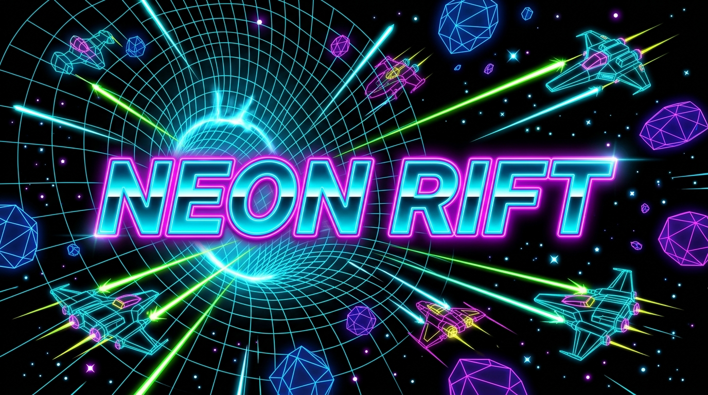

# Asteroids Neon Rift

<p align="center">
  
</p>

Browser game prototype (`codex_asteroids.html`) with local AI/LLM integrations, optional vision server, and local music ingest tooling.

## What Is Included

- Game frontend: `codex_asteroids.html` (supporta sia la modalità visiva completa *Neon Rift* che la modalità *Classico Wireframe* per hardware edge / low-spec)
- Local Node server/proxy: `neon_rift_server.js`
- Edge AI & Decision tooling:
  - `tools/gliclass_worker.js`: Web Worker in-browser per la classificazione tattica System 1 (zero lag, 60 FPS)
  - `tools/export_gliclass_onnx.py`: Script di esportazione e quantizzazione INT8 per modelli GLiClass
- Optional Python vision service: `vision_server.py`
- Music ingest CLI: `ingest_music_catalog.py` (launcher) e `tools/ingest_music_catalog.py`
- Default repo-safe catalog: `music/music_catalog_c64_ogg_subset.json`

## Modalità Edge & Low-Spec (Zero LLM)

Per eseguire Neon Rift su macchine a basse risorse o mini-PC senza GPU dedicata:
- **Motore IA / Backend**: Selezionare `Euristica locale (Zero LLM / Edge)` nel lanciatore o nel menu impostazioni in-game. Bypassa completamente i server Ollama / llama.cpp e gestisce i commenti e le decisioni tattiche tramite regole contestuali e Web Worker a latenza <1ms.
- **Grafica Wireframe**: Selezionare `Classico Wireframe (Edge Low-Spec)` per disattivare gradienti radiali, sfocature, particellari pesanti e onde d'urto, sostituendo le navette e gli asteroidi con una fedele grafica vettoriale stile arcade 1979 e dashboard monocromatica.

## What Is Excluded From Git

User-specific data and large/generated artifacts are ignored via `.gitignore`, including:

- `.venv/`
- `.neon_rift.config.json`
- `music/in_game/` and other local music asset folders
- `graphify-out/`
- `raw/`
- `neon_rift_debug.log`

## Quick Start (Windows)

1. Create and activate venv:

```powershell
py -m venv .venv
.\.venv\Scripts\Activate.ps1
```

2. Install Python deps when needed:

```powershell
pip install -r requirements.txt
pip install -r requirements_vision.txt
```

3. Launch game server:

```powershell
.\launch_neon_rift.bat
```

4. (Optional) launch vision server:

```powershell
.\start_vision_server.bat
```

## Music Ingest

Use the root launcher so you can run from repo root:

```powershell
python .\ingest_music_catalog.py --ingest "C:\path\track.mp3"
```

Common options:

- `--ingest <file|folder|url|manifest.json>` (repeatable)
- `--remove <title|id|relative|absolute|filename>` (repeatable)
- `--lookup-online` and `--lookup-timeout`
- `--title`, `--author`, `--released` (CLI metadata overrides)
- `--dry-run`

Example:

```powershell
python .\ingest_music_catalog.py --ingest "C:\Music\track.sid" --lookup-online --dry-run
```

## Local Config

Copy `.neon_rift.config.example.json` to `.neon_rift.config.json` and customize local paths/endpoints.

## Prepare GitHub Push

See `docs/GITHUB_PUBLISHING.md` for full steps from `git init` to first push.

## Repository Name On GitHub

Recommended GitHub repository name: `neon-rift`

GitHub URLs cannot use spaces in repo names, so `neon rift` should be published as `neon-rift`.

## License

This repository is released under the MIT License. See `LICENSE`.

## Attributions And Third-Party Notes

- C64/SID metadata and references are related to HVSC sources and local user collections. Verify per-track rights before any redistribution.
- Optional online metadata lookup uses the MusicBrainz web service.
- SID to OGG conversion flow can use VLC (`vlc.exe`) when available locally.
- Local AI integrations may use Ollama and/or llama.cpp depending on local setup.
- Vision pipeline may rely on PyTorch/Transformers in local environments.

If you distribute this project publicly, ensure your local ingested media files and metadata are licensed for redistribution.
